# Pipeline CRM

A SaaS-style client management dashboard: sign in, see your pipeline at a glance, manage clients in a table or on a Kanban board, keep notes and a full activity history for every client, and export any view to CSV.

**[Live demo](https://crm-mini-sepia.vercel.app/)** · demo account is pre-filled on the login page (`demo@pipelinecrm.app` / `demo1234`)

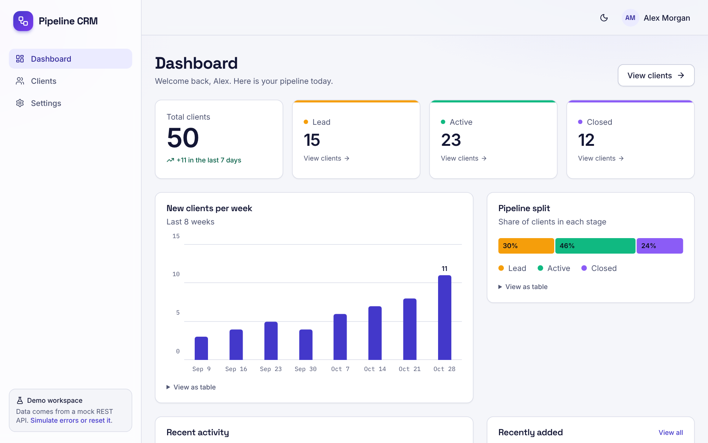

> A short screen recording (GIF) of the main flow will be added here.

| Clients table                                  | Kanban board                                 | Client page                                        |
| ---------------------------------------------- | -------------------------------------------- | -------------------------------------------------- |
| 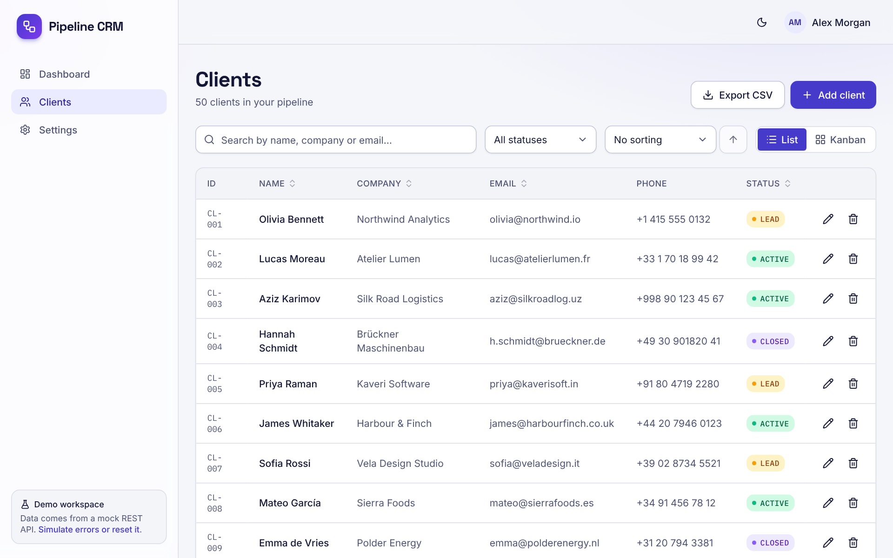 | 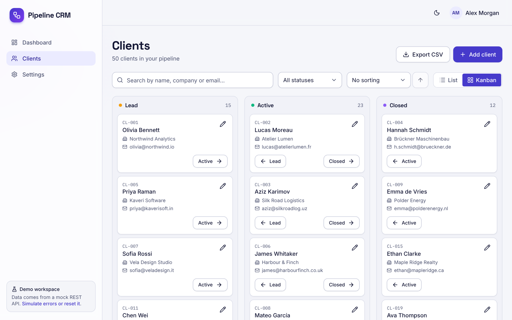 | 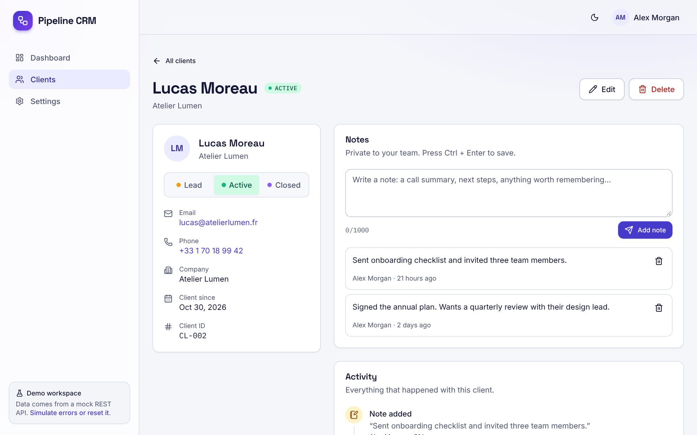 |

| Sign in                                | Form validation                                          | Dark theme                                         | Mobile                                            |
| -------------------------------------- | -------------------------------------------------------- | -------------------------------------------------- | ------------------------------------------------- |
| 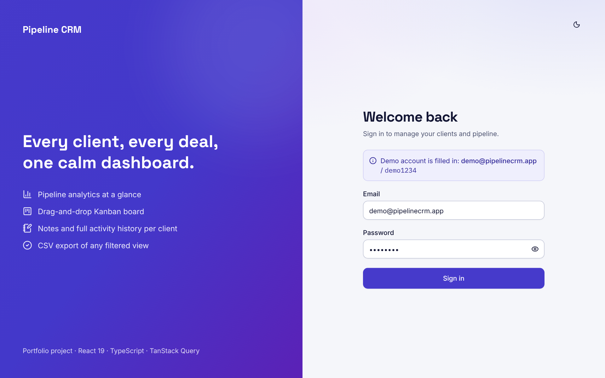 | 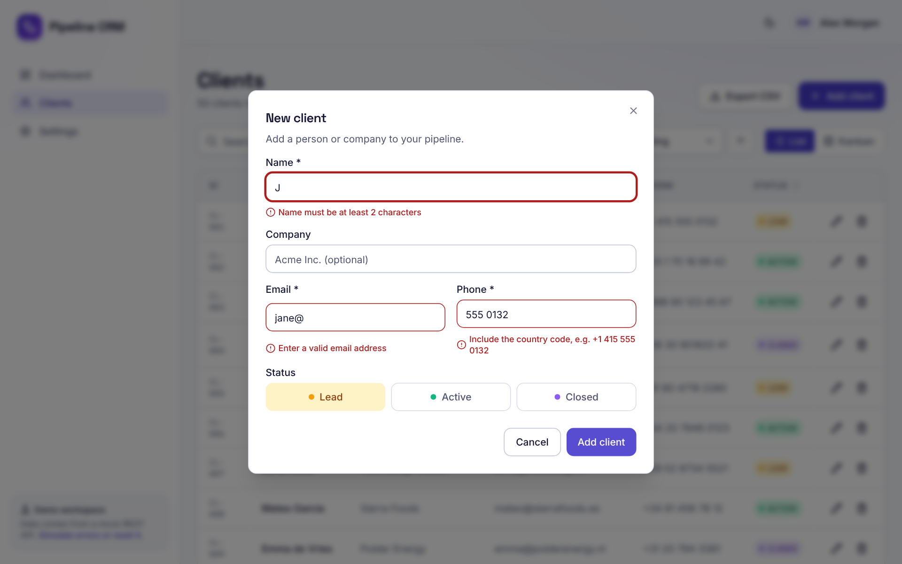 | 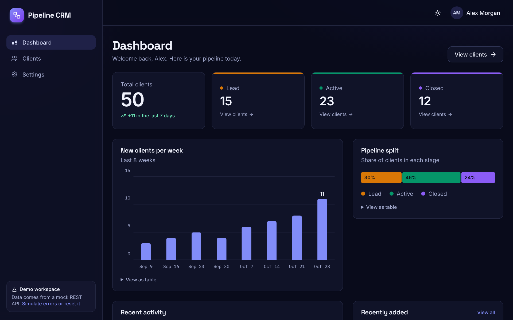 | 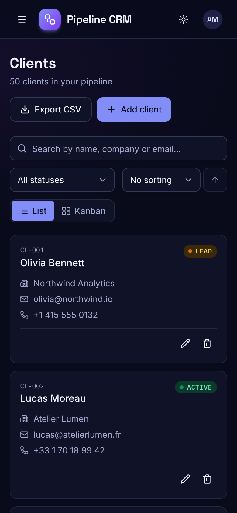 |

| Loading (skeleton)                                | Error with retry                                      | Empty state                                      |
| ------------------------------------------------- | ----------------------------------------------------- | ------------------------------------------------ |
| 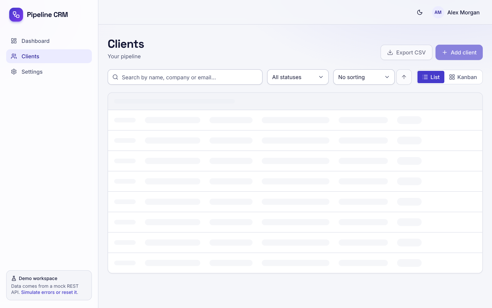 | 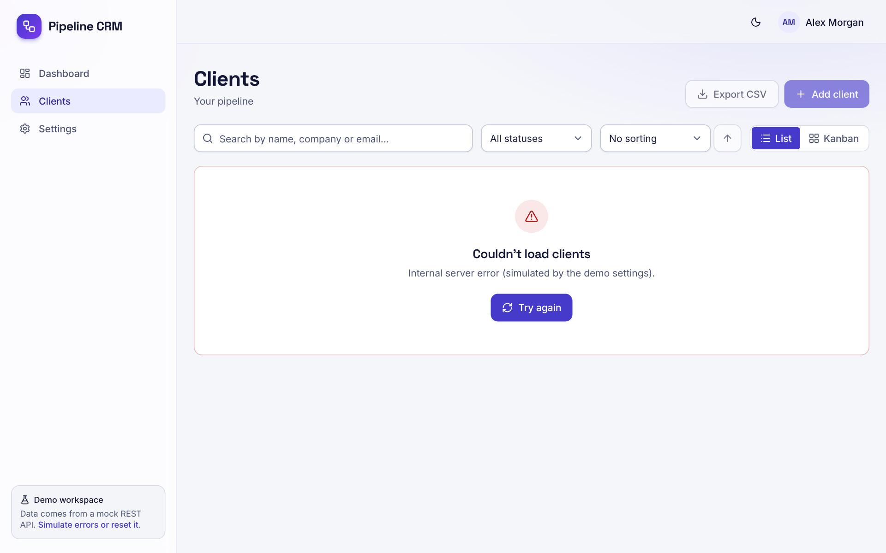 | 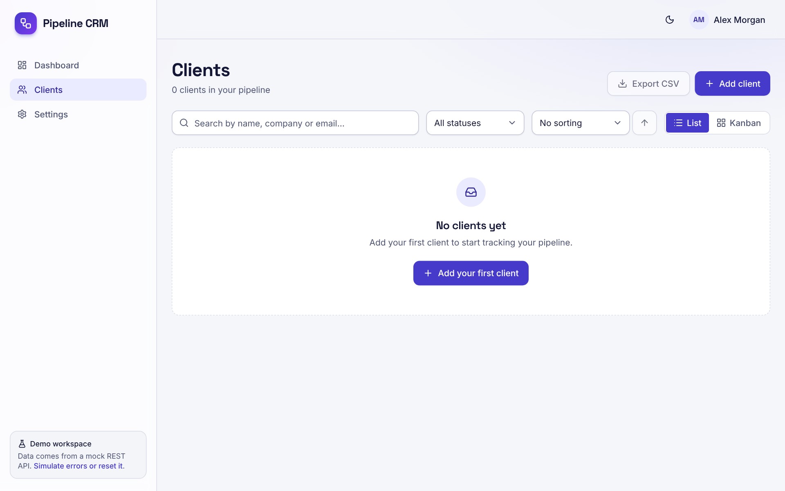 |

## Features

- **Authentication** – login form with validation, protected routes, redirect back to the page you wanted, persisted session, logout, and a clear message when a session expires (any `401` signs you out).
- **Dashboard** – stat tiles (click one to open the client list filtered by that stage), a "new clients per week" column chart, a pipeline split, recent activity across all clients and recently added clients. Every chart has hover/keyboard tooltips and a table view.
- **Clients table** – debounced search across name, company and email, status filter, sortable columns (asc → desc → off, with `aria-sort`), pagination with a page-size selector. Filters live in a Zustand store, so they survive going to a client and back.
- **Kanban board** – drag and drop between Lead, Active and Closed, plus move buttons that work with a keyboard and on touch screens. Moves are optimistic and roll back if the server rejects them.
- **Client page** – contact details with `mailto:`/`tel:` links, a pipeline-stage switcher, notes (add with Ctrl + Enter, delete) and a timeline of everything that happened to the client.
- **Add / edit / delete** – React Hook Form + Zod with inline errors; international phone numbers (`+1 415 555 0132`, `+44 20 7946 0123`, …); server errors such as a duplicate email appear next to the field they belong to; dirty forms are not lost to an accidental outside click.
- **CSV export** – downloads exactly what you are looking at (current search, filter and sort, all pages), with formula-injection protection and a BOM so Excel shows non-ASCII names correctly.
- **REST API** – every read and write is a real `fetch` call (Bearer token included), cached and kept in sync by TanStack Query. The API is implemented with Mock Service Worker, so the live demo needs no server. See [Mock API](#mock-api).
- **Loading, error and empty states everywhere** – skeletons that mirror the real layout, error panels with _Try again_, empty states with a next step. **Settings → Demo API** can switch on a slow network or a 500 error, reload all data, empty the account and restore the demo data.
- **Light / dark / system theme** – applied before the first paint (no flash), remembered per browser.
- **Responsive** – sidebar on desktop, slide-out menu on phones; table on tablet/desktop, cards on phones. Checked at 360, 768, 1024 and 1440 px.
- **Accessible** – semantic landmarks, skip link, labelled controls, visible focus rings, focus management in dialogs (focus returns to where you were), errors announced with `role="alert"`, colour never the only signal. No WCAG 2.1 AA violations reported by axe on any page, in either theme.

## Tech stack

**React 19** · **TypeScript** (strict, no `any`) · **Vite** · **React Router 7** · **TanStack Query 5** · **Zustand 5** · **React Hook Form + Zod 4** · **Tailwind CSS** · **shadcn/ui** (Radix UI primitives) · **sonner** · **lucide-react** · **Mock Service Worker** · **Vitest + React Testing Library** · **Playwright** · **ESLint (typescript-eslint, jsx-a11y) + Prettier** · deployed on **Vercel**

## Getting started

Requires Node.js 20 or newer.

```bash
npm install
cp .env.example .env     # optional: the defaults already work
npm run dev              # http://localhost:5173
```

| Script             | What it does                                                     |
| ------------------ | ---------------------------------------------------------------- |
| `npm run dev`      | Start the dev server                                             |
| `npm run build`    | Type-check and build for production                              |
| `npm run preview`  | Serve the production build                                       |
| `npm run lint`     | ESLint (`npm run lint:fix` to auto-fix)                          |
| `npm run format`   | Prettier (`npm run format:check` in CI)                          |
| `npm test`         | Unit and integration tests (Vitest)                              |
| `npm run test:e2e` | End-to-end tests (Playwright, desktop and mobile)                |
| `npm run check`    | Type-check + lint + format check + tests + build (before a push) |

Before the first E2E run, install the browser once: `npx playwright install chromium`.

## Folder structure

```
src/
├── app/                 # App, providers, route table (lazy pages, protected routes)
├── pages/               # one thin component per route
├── features/
│   ├── auth/            # login form, protected/public routes, auth api + hooks, schema
│   ├── clients/         # table, cards, Kanban, form dialog, delete dialog, api, hooks, schema, utils
│   ├── notes/           # notes panel and form, api, hooks, schema
│   ├── activity/        # timeline, api, hooks, describeActivity
│   ├── dashboard/       # stat tiles, charts, recent lists, stats utils
│   └── settings/        # appearance, account, demo API controls
├── components/
│   ├── ui/              # shadcn/ui primitives (button, dialog, form, table, …)
│   ├── layout/          # app shell: sidebar, top bar, mobile menu, user menu, theme toggle
│   └── common/          # EmptyState, ErrorState, Pagination, PageHeader, loaders
├── store/               # Zustand: auth session, client filters/view, theme
├── hooks/               # useDebounced, useDocumentTitle, useResolvedTheme, useReturnFocus
├── lib/                 # http client, query client, constants, routes, csv, dates, phone, utils
├── mocks/               # MSW handlers, in-memory database, seed data, mock auth, demo controls
└── test/                # test setup and render helpers
e2e/                     # Playwright specs
docs/screenshots/        # images used in this README
```

Components never call `fetch`: `features/*/api.ts` knows nothing about React and `features/*/hooks.ts` knows nothing about URLs.

## Mock API

Mock Service Worker intercepts `fetch` in the browser, so the app runs exactly the code it would run against a real server. The same handlers serve the Vitest suite in Node. Data is kept in memory and mirrored to `localStorage`, so it survives a reload. Requests take about 400 ms so loading states are visible.

| Method   | Endpoint                         | Result                                              |
| -------- | -------------------------------- | --------------------------------------------------- |
| `POST`   | `/api/auth/login`                | `{ token, user }` · `401` wrong credentials · `422` |
| `POST`   | `/api/auth/logout`               | `204`                                               |
| `GET`    | `/api/clients`                   | list                                                |
| `POST`   | `/api/clients`                   | `201` · `422` invalid · `409` email already used    |
| `GET`    | `/api/clients/:id`               | client · `404`                                      |
| `PATCH`  | `/api/clients/:id`               | updated client · `404` · `422` · `409`              |
| `DELETE` | `/api/clients/:id`               | `204` (notes and history are deleted too) · `404`   |
| `GET`    | `/api/clients/:id/notes`         | notes, newest first                                 |
| `POST`   | `/api/clients/:id/notes`         | `201` · `422` · `404`                               |
| `DELETE` | `/api/clients/:id/notes/:noteId` | `204` · `404`                                       |
| `GET`    | `/api/clients/:id/activity`      | the client's history                                |
| `GET`    | `/api/activity?limit=8`          | latest events across all clients                    |
| `POST`   | `/api/demo/reset`                | demo only: `{ "dataset": "seed" \| "empty" }`       |

Every route except `/auth/*` requires `Authorization: Bearer <token>`. Errors are `{ "message": "...", "fields": { "email": "..." } }`, and the form maps `fields` onto its inputs. Validation uses the **same Zod schemas** as the forms, so client and server rules cannot drift apart.

**Switching to a real backend:** set `VITE_ENABLE_MOCKS=false` and `VITE_API_URL=https://your-api.example.com` in `.env`. The mock code is then not even built into the bundle.

## Testing

- **175 unit and integration tests** (Vitest + Testing Library) cover the utilities (sorting, filtering, pagination, CSV escaping, phone validation, relative dates, chart buckets), the Zod schemas, the mock database and auth, the HTTP contract of every endpoint (status codes, validation, duplicates, 401 handling, network failures), the data hooks (including optimistic rollback) and full user flows through the real router: sign in/out and session expiry, search, filters, sorting, pagination, add/edit/delete with server errors, Kanban moves (buttons and drag and drop), CSV content, notes, activity, settings, error/retry and empty states.
- **18 end-to-end tests** (Playwright, desktop Chrome and Pixel 7) run against the production build: protected routes, wrong password, session persistence, add → edit → delete, duplicate email, persistence after reload, client notes and stage changes, deep links, and the demo error switch.

## Quality checks

| Check                                                        | Result                                                                    |
| ------------------------------------------------------------ | ------------------------------------------------------------------------- |
| TypeScript strict / ESLint / Prettier                        | clean                                                                     |
| axe (WCAG 2.1 AA), all pages, light + dark, desktop + mobile | 0 violations                                                              |
| Lighthouse, desktop                                          | Performance 99 · Accessibility 100 · Best Practices 100 · SEO 100         |
| Lighthouse, mobile (slow 4G simulation)                      | Performance 82–86 · Accessibility 100 · Best Practices 100 · SEO 100      |
| Main bundle                                                  | ≈124 kB gzipped; every page, the app shell and toasts are separate chunks |

The mobile performance score is limited by the size of React 19 + React Router + form libraries over a simulated slow 4G connection; the mock API (≈104 kB gzipped) loads after the first paint, and is not part of a real-backend build.

## My contribution and problems solved

I designed and built the whole front end: architecture, UI, data layer, mock backend, tests and deployment. Some of the problems worked through along the way:

- **A demo that behaves like a real product without a server.** Mock Service Worker plus a small in-memory database with `localStorage` persistence gives real HTTP semantics (auth headers, status codes, validation, conflicts) on a static host, and the same handlers power the tests.
- **One source of truth for validation.** The Zod schemas are shared by React Hook Form and the API handlers; server field errors (e.g. a duplicate email) come back as `fields` and land on the right input with focus.
- **Snappy but honest UI.** Kanban and stage changes are optimistic with rollback and a toast on failure; other mutations wait for the server and show progress; every query has loading, error-with-retry and empty states.
- **Auth edge cases.** Redirect back after login, persisted session, global handling of `401` (sign out with an explanation), and cached data cleared on logout so the next user never sees it.
- **Accessibility details that usually get skipped.** Focus returns to the row or button that opened a dialog (Radix only does that for its own triggers), charts have accessible names, tooltips on focus and table views, the status palette was validated for colour-blind safety and contrast in both themes.
- **First-load performance.** Pages, the app shell and the toast library are lazy chunks; the mock API starts when the browser is idle and requests wait for it, so it never blocks the first paint.
- **Safe CSV export.** RFC 4180 quoting, protection against spreadsheet formula injection that still leaves `+1 415…` phone numbers intact, and a BOM for Excel.

## Deployment

Deployed on Vercel. `vercel.json` rewrites every route to `index.html` (so deep links such as `/clients/CL-003` work after a reload) and serves `mockServiceWorker.js` without caching.

## Possible next steps

A real backend (the API contract above is ready), server-side search and pagination, roles and permissions, CSV import, email integration.
