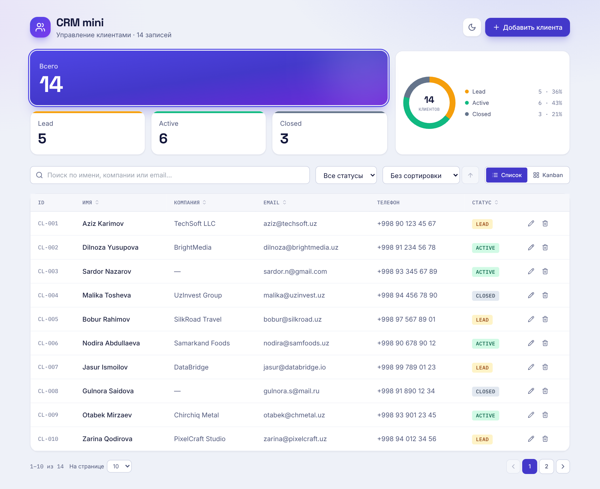
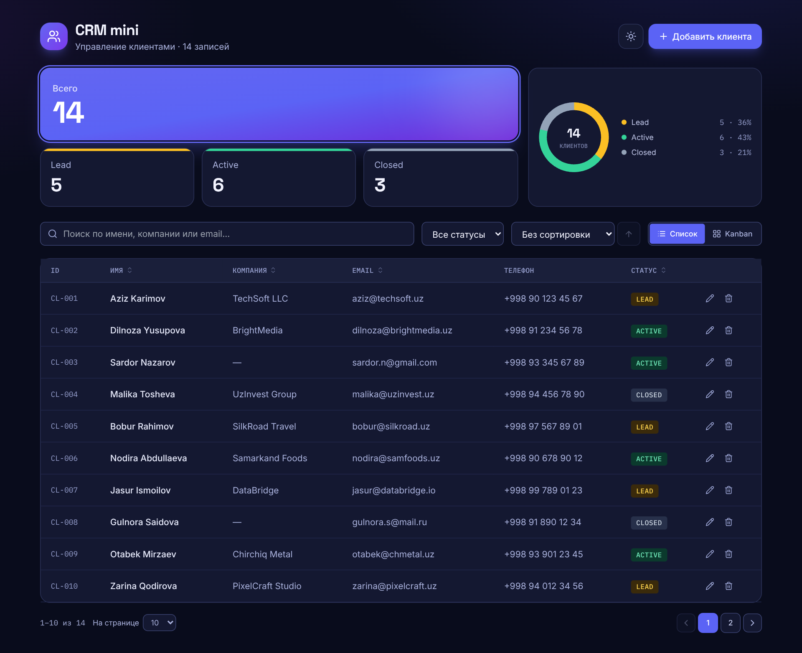
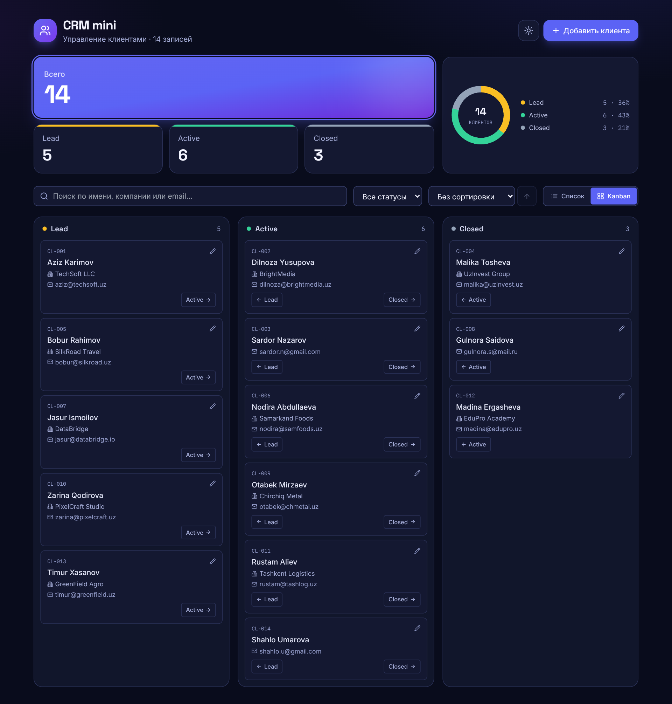
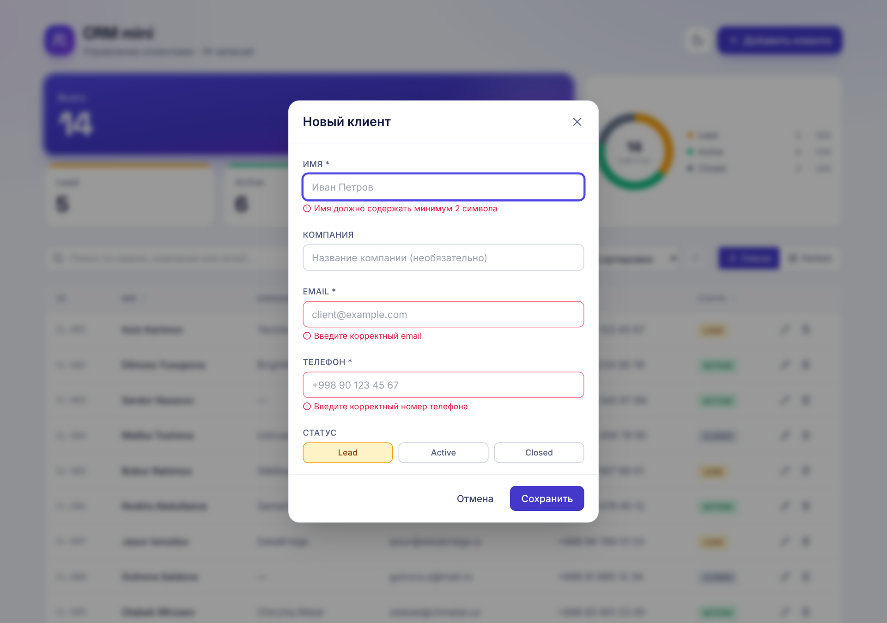
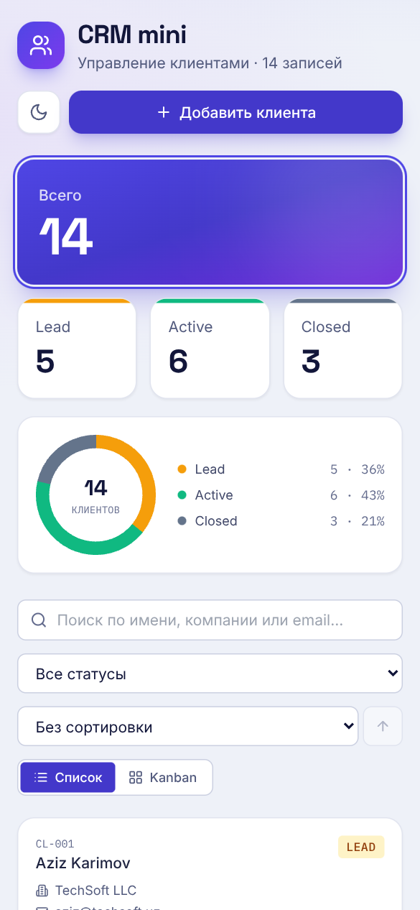
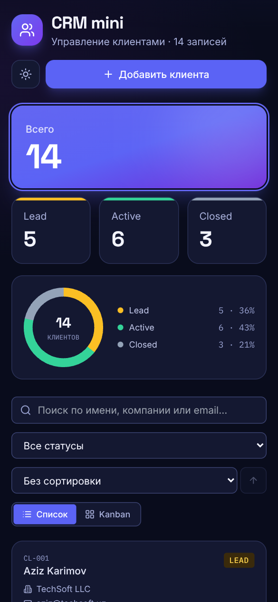

# CRM mini

A lightweight client-management app: dashboard stats, searchable and sortable client table, Kanban board with drag & drop, validated forms and accessible dialogs. Light and dark themes, fully responsive, built with React + TypeScript, no backend required.

**[Live demo](https://crm-mini-sepia.vercel.app/)**

| Light | Dark |
| --- | --- |
|  |  |

| Kanban board | Form validation | Mobile (light) | Mobile (dark) |
| --- | --- | --- | --- |
|  |  |  |  |

## The problem

Small teams track clients in spreadsheets: no pipeline view, no validation, painful on a phone. This project is a compact CRM that solves exactly that and shows how I build production-style front-end features end to end.

## Features

- **Dashboard** – counters per status (click to filter) and a donut chart drawn in plain SVG (no chart library, smaller bundle).
- **Client table** – debounced search (name / company / email), status filter, sortable columns (asc → desc → none), pagination with page-size selector.
- **Kanban board** – drag & drop between `Lead / Active / Closed`, plus arrow buttons so it also works on touch screens and with a keyboard.
- **Add / edit / delete** – form validation with inline errors, `+998 XX XXX XX XX` phone mask, delete confirmation, toast notifications.
- **Light / dark theme** – follows the system setting by default, remembers the manual choice, and is applied before first paint (no white flash). Colours are CSS variables, so components contain no duplicated `dark:` classes.
- **Responsive** – table on desktop, card list on phones; no horizontal scrolling.
- **Persistent** – data survives reloads via `localStorage`. Saved data is validated: broken records are skipped, and if nothing usable is left the app falls back to demo data. IDs of deleted clients are never reused.

## Accessibility

- Reusable `Modal`: `role="dialog"` / `alertdialog`, focus trap, Escape to close, focus returns to the opener, page scroll locked.
- Labels linked to inputs, errors announced via `role="alert"` and `aria-describedby`, `aria-invalid` on bad fields.
- Text colours meet WCAG AA contrast (4.5:1) in both themes; the page has a `<main>` landmark and a meta description.
- Sortable headers expose `aria-sort`; toasts use a polite live region; every button and field has a visible keyboard focus ring.
- Everything is usable without a mouse, including the Kanban board (each card has its own edit and move buttons).
- A dirty form is not discarded by an accidental click outside the dialog.

## Tech stack

React 18 · TypeScript (strict) · Vite · Tailwind CSS · lucide-react · Vitest + Testing Library · Fontsource (self-hosted Inter, Space Grotesk, IBM Plex Mono)

## Getting started

Requires Node.js 18 or newer.

```bash
npm install
npm run dev        # http://localhost:5173
```

| Script | What it does |
| --- | --- |
| `npm run dev` | Start the dev server |
| `npm run build` | Type-check and build for production |
| `npm run preview` | Preview the production build |
| `npm run typecheck` | `tsc --noEmit` in strict mode |
| `npm test` | Run all tests once |
| `npm run test:watch` | Tests in watch mode |
| `npm run check` | Type-check + tests + build (use before pushing) |

## Testing

80 tests cover the business logic (sorting, pagination, validation, phone formatting, ID generation, storage hook) and the real user flows through the UI: search, filters, sorting, pagination, add / edit / delete, modal keyboard behaviour, theme switching, Kanban moves and regression cases such as unknown statuses and missing companies.

## Project structure

```
src/
├── components/   # small, single-purpose components (Modal, FormField, Pagination, StatsCards, StatusChart, ...)
├── hooks/        # useClients (CRUD + localStorage), useDebounced, useTheme
├── utils/        # pure, unit-tested helpers (sortClients, pagination, validation, formatPhone, ...)
├── test/         # test setup
├── types.ts      # shared domain types
├── App.tsx
└── main.tsx
docs/screenshots/ # images used in this README
```

## Design decisions

- **Pure logic in `utils/`** so it is trivial to test and reuse; components stay thin.
- **No chart or UI kit dependencies** – the donut chart, modal and pagination are hand-built, keeping the JS bundle around 57 kB gzipped.
- **Self-hosted fonts** – no render-blocking requests to third-party domains; thanks to `unicode-range` the browser downloads only the Latin/Cyrillic subsets it actually needs.
- **One `Modal` component** powers both the form and the delete confirmation, so accessibility is implemented once.
- **Theme via CSS variables** – the Tailwind palette points at variables defined in `index.css`; switching the `.dark` class on `<html>` re-themes the whole app, including status colours and the SVG chart.
- **Mobile is a first-class layout**, not a shrunk desktop: cards instead of a table, button-based Kanban moves instead of HTML5 drag & drop only.

## Possible next steps

REST/GraphQL backend with authentication, server-side pagination, CSV import/export, activity history per client.
